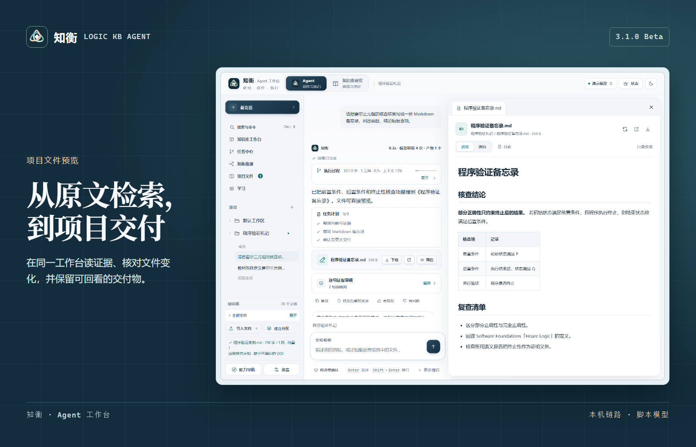

# 知衡 v3.1.0 Beta 发布素材

**本地准备版 · 2026-11-24**。截图取自 `420b373`，图注标明实机界面、脚本模型或外部服务待验证。打开图册可以选图并查看原尺寸。单张 PNG 自带 Beta 版号与验收标记。



## 图册与文案

- [界面图册](gallery.html)可离线打开，收录 39 张界面图和 3 张宣传海报。界面图按开始、研究、执行与交付、技能与设置分组。PNG 在同目录的 `images/` 中。
- [产品封面](images/00-cover.png)、[原文与引用](images/00-evidence.png)、[社区技能与插件](images/00-community.png)是可单独配文的三张海报。
- [功能手册](features.md)说明每项能力的操作入口、限制和实际验证范围。
- [社区扩展指南](community.md)列出可自定义的部分、优先贡献任务和验收方式。另有[贡献入口](../../CONTRIBUTING.md)、[技能包样例](../../examples/community/evidence-desk-pack/plugin.json)与[本地 MCP 样例](../../examples/community/glossary-mcp.mjs)。
- [项目署名与素材来源](credits.md)用于发布时的原创实现、语料、视觉和第三方致谢。第一方代码与文档采用 [Apache-2.0](../../LICENSE)，完整第三方声明见 [NOTICE](../../NOTICE)，安全反馈见[安全策略](../../SECURITY.md)。

## 产品短介绍

知衡是一款本地运行的中文研究与 Agent 工作台。知识库研究模式可以检索教材和自有文献、打开引用原文，并把核对过的结论留给下一次研究。Agent 模式围绕本机项目工作，文件修改可先看差异再批准，交付物可在对话旁边预览。HanLogic 让中文条件和规则可以运行，查看给定前提能推出哪些结论。

**v3.1.0 Beta。** 当前提供 Windows x64 便携版。模型、搜索和外部工具由用户选择和配置。已验收的内置功能、演示流程和待验证的集成见[功能手册](features.md#beta-验收范围)。

## 素材复验

截图用公开形式逻辑教材和本轮自制的演示文件。研究问题、计划和应答文本由脚本提供，应用实际执行检索、逐字引文校验、文件差异复核、规则示例、参考文献下载、技能包导出回读和本机 MCP 调用。工作区路径与回环模型地址作遮挡。宣传图保留界面内容，版本与题注位于外框。

2026-11-24 在 Windows 隔离源码副本通过 697 项回归，23 张样式表检查无违规，公开教材核对为 25 章、712 个片段。图册在 1440 和 390 px 的 Chromium 视口检查，图片均可加载和打开。

需要 Node.js 与项目锁定依赖，以及 Python Playwright 和对应 Chromium。以下命令在临时目录重建素材。为长期对比留存 [manifest.json](manifest.json) 中的基线、浏览器、尺寸和 SHA-256。

```powershell
$raw = Join-Path $env:TEMP ("zh-captures-" + [guid]::NewGuid())
$kit = Join-Path $env:TEMP ("zh-gallery-" + [guid]::NewGuid())
python scripts/capture-release-ui.py --ref 420b373 --output $raw
python scripts/render-release-gallery.py --captures $raw --kit $kit --date 2026-11-24
```

`--kit` 指向素材输出目录。要连同手册离线分发，请保留本目录与仓库中相对链接所需的原文件。
